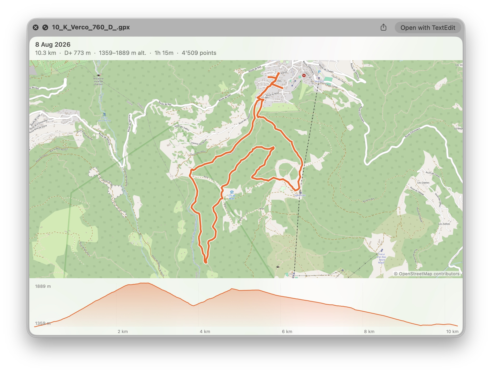

# QuickGPX



macOS Quick Look support for `.gpx` files:

- **Press Space on a GPX file in Finder** → the track drawn on an OpenStreetMap base map, titled with the date, plus a stats bar: distance (km), D+ (cumulative ascent), altitude range, duration (when the file has timestamps), and point count. An elevation profile (altitude vs. distance) is drawn under the map when the file carries elevation data; hovering it shows a crosshair with distance/altitude and marks the spot on the map.

- **Finder thumbnails** → the track outline drawn as the file's icon.

Legacy `.qlgenerator` plugins stopped working in macOS 15 (Sequoia), so this is
built the modern way: a minimal host app carrying a Quick Look **preview
extension** (`QLPreviewingController` + MapKit) and a **thumbnail extension**
(`QLThumbnailProvider`). No Xcode project — everything is compiled with `swiftc`
and assembled by the build script.

## Changes in this fork

This fork of [nst/QuickGPX](https://github.com/nst/QuickGPX) changes how the preview uses the network:

- The base map uses OpenStreetMap tiles from `tile.openstreetmap.org`. The upstream version uses Thunderforest Outdoors tiles with the API key of the upstream author.
- The preview does not send the start point of a track to OSM Nominatim. The title shows the date, the track name, or the file name.

The OSM tiles are 256 px, so the map is less sharp on Retina displays.

## Build & install

```sh
./build.sh
```

This compiles, assembles `QuickGPX.app`, ad-hoc signs it, installs it to
`~/Applications`, and registers the extensions. Then select any `.gpx` file in
Finder and press Space. Requires Xcode (or at least its toolchain + SDK).

If previews don't appear: check that "QuickGPX" is enabled under
System Settings → General → Login Items & Extensions → Quick Look.

## Release (distributable build)

```sh
./build.sh --release
```

Signs with Developer ID (hardened runtime + timestamp), notarizes, staples,
and writes a distributable `dist/QuickGPX-<version>.zip`. One-time setup for
notarization credentials:

```sh
xcrun notarytool store-credentials notary \
    --apple-id <apple-id> --team-id VBYRKYS73S \
    --password <app-specific-password>   # from appleid.apple.com
```

Not App Store material: the sbpl entitlement below would be rejected by review
(notarization, being a malware scan rather than a policy review, accepts it).

## Uninstall

```sh
rm -rf ~/Applications/QuickGPX.app && qlmanage -r
```

## Layout

```
Sources/Shared/GPXDocument.swift        GPX parser (trk/rte/wpt) + stats
Sources/Preview/PreviewViewController.swift   map preview extension
Sources/Thumbnail/ThumbnailProvider.swift     thumbnail extension
Sources/App/main.swift                  minimal host app
Config/                                 Info.plists + entitlements
build.sh                                compile, bundle, sign, install, register
```

## Notes on the Quick Look sandbox

Quick Look preview extensions run under the system's `quicklook-preview.sb`
sandbox profile, which **denies all networking** regardless of the
`com.apple.security.network.client` entitlement. Consequences:

- Apple's own map tiles can never load (GeoServices is blocked), so the map
  uses an `MKTileOverlay` with `canReplaceMapContent` fetching web tiles directly.
  The tiles come from tile.openstreetmap.org (256px, so less sharp on Retina).
- The network access needed for those tile fetches is granted through
  `com.apple.security.temporary-exception.sbpl` entitlements
  (`(allow network-outbound)`), which the profile explicitly honors.

The thumbnail extension needs no network — it draws the track vector directly.

macOS caches aggressively: `build.sh` runs `qlmanage -r`, resets the cache, and
restarts `ThumbnailsAgent`, which otherwise keeps serving a stale extension list.
